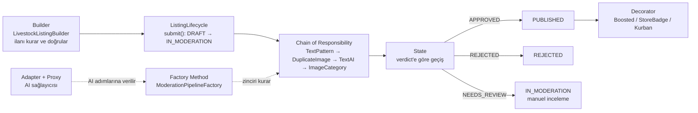

# MERA İlan Çekirdeği

MERA; büyükbaş, küçükbaş ve kanatlı hayvan ilanları için sahibinden tarzı bir uygulamadır (asıl uygulama React Native + Supabase). Bu repo, MERA'nın **ilan çekirdeğinin** ders için hazırlanmış, bağımsız ve arayüzsüz TypeScript sürümüdür: ilan kurma, moderasyon, yaşam döngüsü ve vitrin özellikleri. **7 GoF tasarım kalıbı** ile yazılmıştır ve her kalıp kendi klasöründe açıkça görünür.

## Çözülen 3 problem

1. **Kategoriye göre değişen opsiyonel alanlar.** Süt verimi, gebelik, doğum sayısı, küpe no ve video her ilanda geçerli değildir. İlan adım adım kurulur ve `build()` anında doğrulanır (**Builder**).
2. **Yayın öncesi maliyetli AI kontrolleri.** Yapay zekâ çağrısı pahalı ve yavaştır. Önce ucuz kontroller (regex, kopya fotoğraf) çalışır, kesin reddedilen ilan AI'a gitmez (**Chain of Responsibility**). AI sağlayıcısı değiştirilebilir (**Adapter**), çağrılar önbelleklenir ve sınırlanır (**Proxy**), test ortamı gerçek AI yerine sahte sağlayıcı kurar (**Factory Method**).
3. **İlan yaşam döngüsü ve birleştirilebilir özellikler.** İlanın hangi durumda hangi işleme izin verdiği tek yerde tutulur (**State**). Doping, mağaza rozeti ve Kurban etiketi iç içe eklenebilir (**Decorator**).

## Genel akış



Akışı `src/services/ListingService.ts` yürütür.

## Kalıp tablosu

| Kalıp | Grup | Dosya yolu | GoF rolleri | Çözdüğü problem |
|---|---|---|---|---|
| Builder | Yaratımsal | `src/patterns/builder/` | `ListingBuilder` (Builder), `LivestockListingBuilder` (ConcreteBuilder), `LivestockListing` (Product) | Kategoriye özgü opsiyonel alanlı ilanı doğrulayarak kurmak |
| Factory Method | Yaratımsal | `src/patterns/factory-method/` | `ModerationPipelineFactory` (Creator), `ProductionPipelineFactory` ve `TestPipelineFactory` (ConcreteCreator) | Zincirin hangi AI sağlayıcısıyla kurulacağını alt sınıfa bırakmak |
| Adapter | Yapısal | `src/patterns/adapter/` | `AIModelProvider` (Target), `ClaudeProviderAdapter` (Adapter), `AnthropicLike` (Adaptee), `FakeAIProvider` (test gerçeklemesi) | Anthropic SDK'sını kendi tiplerimize çevirmek, sağlayıcıyı değiştirilebilir yapmak |
| Proxy | Yapısal | `src/patterns/proxy/` | `CachingRateLimitedProviderProxy` (Proxy), içindeki `AIModelProvider` (RealSubject) | AI çağrılarını önbellekleyip dakikalık sınırlamak |
| Decorator | Yapısal | `src/patterns/decorator/` | `Listing` (Component), `LivestockListing` (ConcreteComponent), `ListingDecorator` (Decorator), `BoostedListing`, `StoreBadgeListing`, `KurbanListing` (ConcreteDecorator) | Rozet ve sıralama puanını sınıf patlaması olmadan birikimli eklemek |
| Chain of Responsibility | Davranışsal | `src/patterns/chain-of-responsibility/` | `ModerationHandler` (Handler), `TextPatternHandler`, `DuplicateImageHandler`, `TextAIHandler`, `ImageCategoryHandler` (ConcreteHandler) | Kontrolleri ucuzdan pahalıya sıralayıp kesin redde AI'ı atlamak |
| State | Davranışsal | `src/patterns/state/` | `ListingLifecycle` (Context), `ListingState` (State), `DraftState`, `InModerationState`, `PublishedState`, `SoldState`, `ExpiredState`, `RejectedState` (ConcreteState) | Yaşam döngüsündeki geçerli ve geçersiz geçişleri durum sınıflarına dağıtmak |

## Hızlı başlangıç

```bash
npm install
npm test
npm run demo
```

Node 20 veya üstü gerekir. Ayrıntı için [kurulum rehberine](docs/KURULUM.md) bakın.

## Dokümanlar

- [docs/KURULUM.md](docs/KURULUM.md): gereksinimler, kurulum, `.env`, gerçek AI demosu, sık hatalar
- [docs/TEST.md](docs/TEST.md): test stratejisi, test tablosu, coverage sonucu, manuel senaryolar
- [docs/TASARIM_KALIPLARI.md](docs/TASARIM_KALIPLARI.md): her kalıp için problem, roller, sınıf diyagramı, kod alıntısı, tasarım kararları

## Klasör yapısı

```
src/
  domain/                 ortak tipler (Category, Species, Verdict, ModerationResult)
  patterns/<kalıp-adı>/   her kalıp kendi klasöründe
  services/ListingService.ts
  demo.ts
tests/<kalıp-adı>.test.ts
docs/
```

## Hazırlayan

Asım Samet Simit (bireysel proje). Ders: Tasarım Kalıpları (EBLG443).
