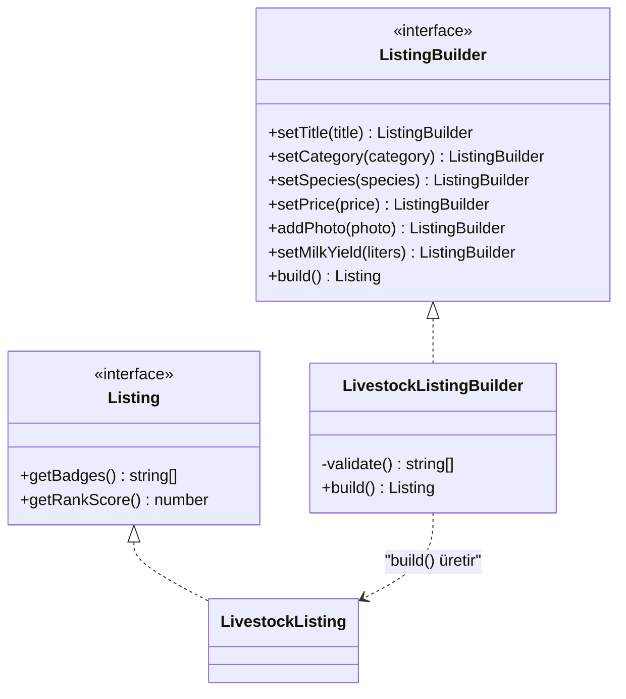
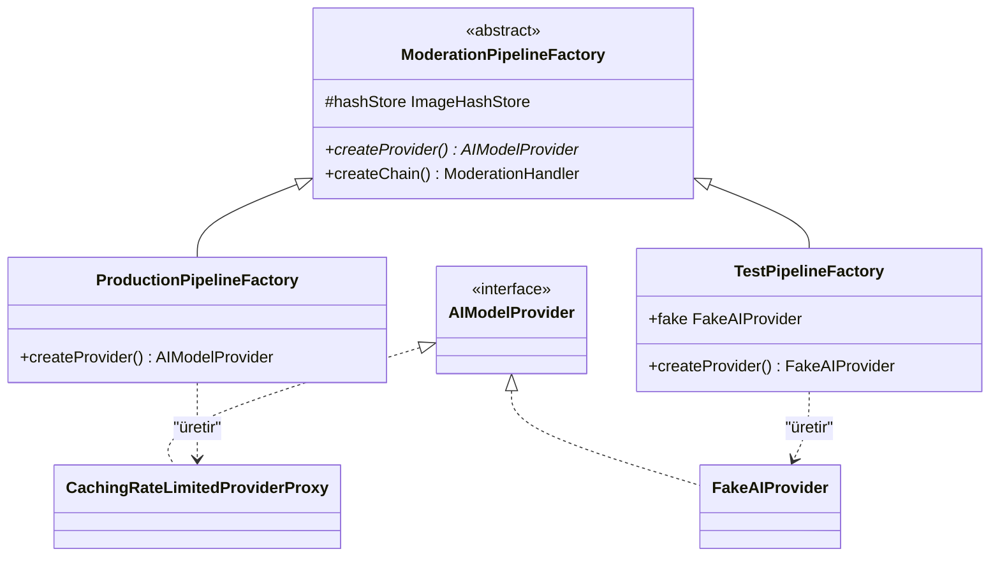
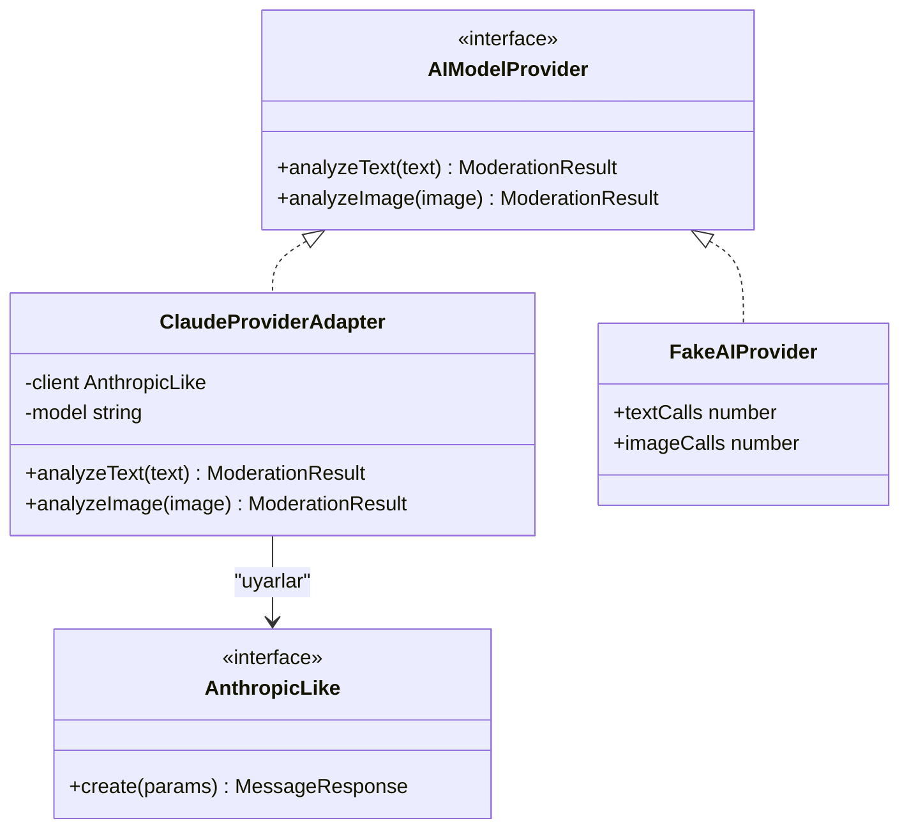
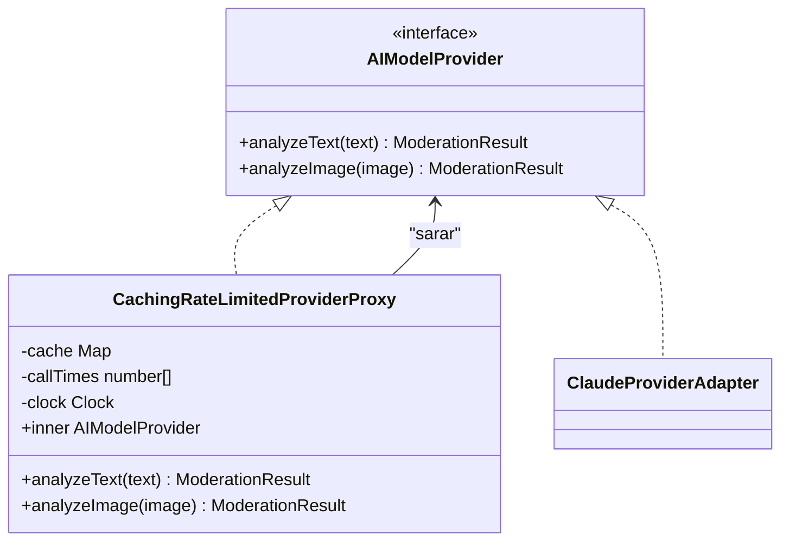
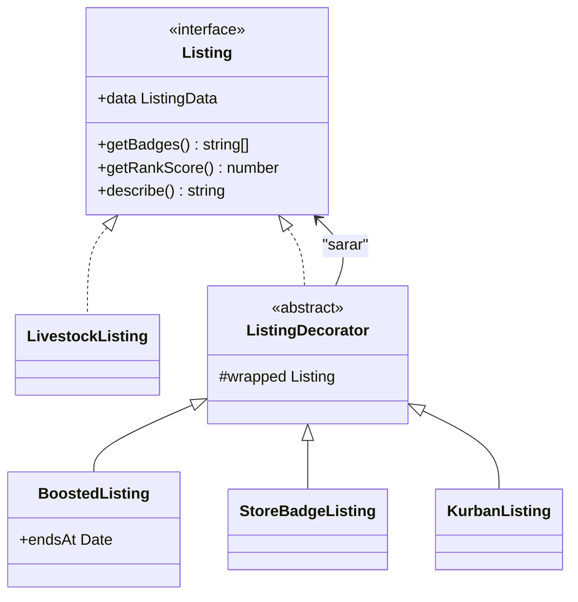
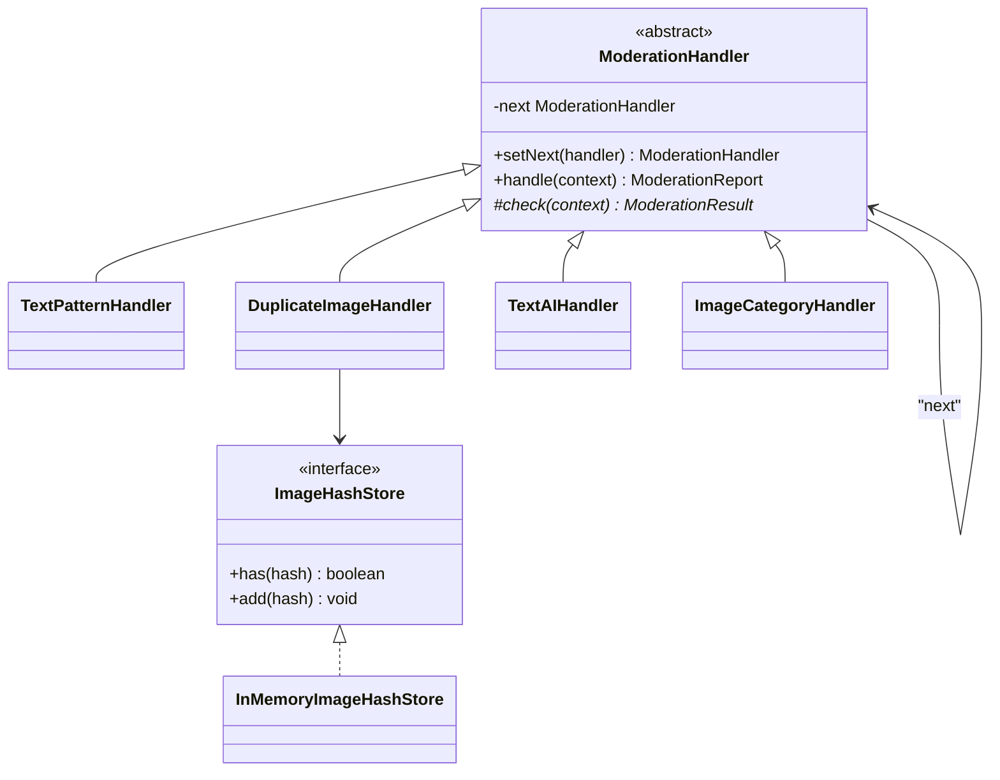
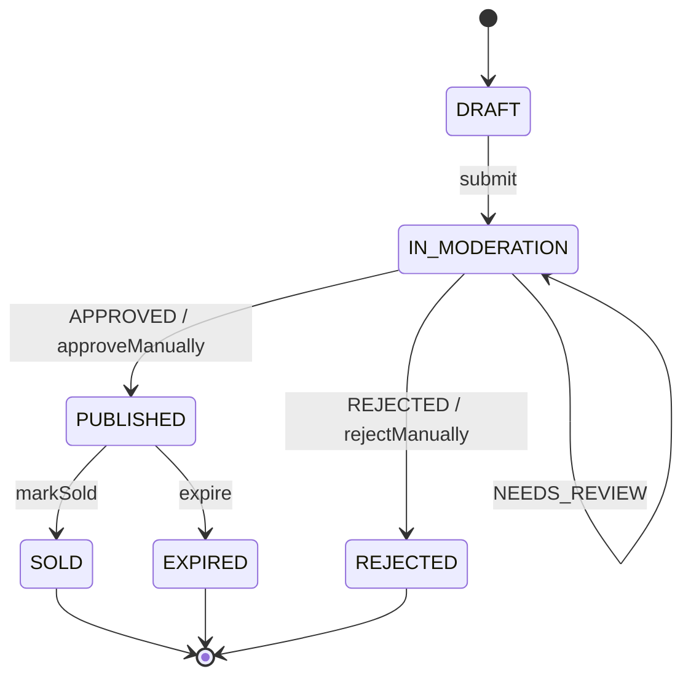
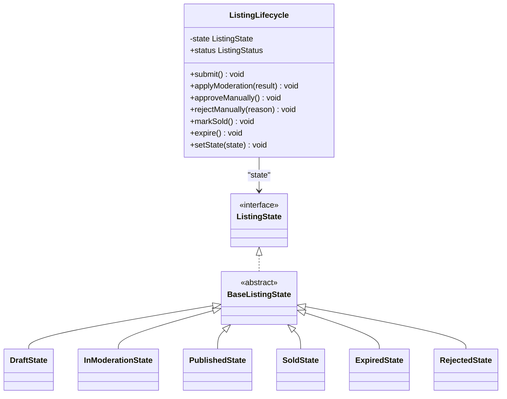

# Tasarım Kalıpları

[← README](../README.md) · [Kurulum](KURULUM.md) · [Test](TEST.md)

Bu doküman, MERA ilan çekirdeğinde kullanılan 7 GoF kalıbını açıklar. Her kalıp için problem, neden o kalıbın seçildiği, roller ve koddaki karşılıkları, sınıf diyagramı, gerçek koddan alıntı ve ilgili test dosyası verilir. Her kaynak dosyanın ilk satırında `// KALIP: ... | ROL: ...` başlığı, her sınıfın üstünde `// GoF rolü: ...` yorumu vardır.

| # | Kalıp | Grup |
|---|---|---|
| 1 | [Builder](#1-builder) | Yaratımsal |
| 2 | [Factory Method](#2-factory-method) | Yaratımsal |
| 3 | [Adapter](#3-adapter) | Yapısal |
| 4 | [Proxy](#4-proxy) | Yapısal |
| 5 | [Decorator](#5-decorator) | Yapısal |
| 6 | [Chain of Responsibility](#6-chain-of-responsibility) | Davranışsal |
| 7 | [State](#7-state) | Davranışsal |

---

## 1. Builder

**Grup:** Yaratımsal · **Klasör:** `src/patterns/builder/`

**Problem.** İlanın başlık, kategori, tür, fiyat, il ve fotoğraf gibi zorunlu alanlarının yanında süt verimi, gebelik, doğum sayısı, küpe no ve video gibi kategoriye bağlı opsiyonel alanları vardır. Bunları tek bir yapıcıya (constructor) yığmak okunmaz ve kuralları dağıtır (ör. süt verimi yalnızca dişi büyükbaş/küçükbaş için geçerlidir).

**Neden Builder?** Alanlar adım adım set edilir, tüm kurallar `build()` içinde tek yerde doğrulanır ve geçersiz ilan hiç oluşmaz.

| GoF rolü | Koddaki karşılığı |
|---|---|
| Builder | `ListingBuilder` (`src/patterns/builder/ListingBuilder.ts`) |
| ConcreteBuilder | `LivestockListingBuilder` (`src/patterns/builder/LivestockListingBuilder.ts`) |
| Product | `LivestockListing` (`src/patterns/builder/LivestockListing.ts`), `Listing` arayüzünü uygular |
| Director | `ListingService.buildListing()` ve çağıran kod |



Kod (`src/patterns/builder/LivestockListingBuilder.ts`, satır 138-151): kategoriye özgü alan kuralları.

```ts
    const isLivestock = this.category === 'BUYUKBAS' || this.category === 'KUCUKBAS';
    const isFemaleLivestock = isLivestock && this.sex === 'female';
    if (this.milkYieldLiters !== undefined && !isFemaleLivestock) {
      problems.push('süt verimi yalnızca büyükbaş/küçükbaş dişi için geçerli');
    }
    if (this.milkYieldLiters !== undefined && this.milkYieldLiters < 0) {
      problems.push('süt verimi negatif olamaz');
    }
    if ((this.pregnant !== undefined || this.birthCount !== undefined) && !isFemaleLivestock) {
      problems.push('gebelik/doğum sayısı yalnızca büyükbaş/küçükbaş dişi için geçerli');
    }
    if (this.earTagNo !== undefined && !isLivestock) {
      problems.push('küpe no yalnızca büyükbaş/küçükbaş için geçerli');
    }
```

**Test:** `tests/builder.test.ts`

---

## 2. Factory Method

**Grup:** Yaratımsal · **Klasör:** `src/patterns/factory-method/`

**Problem.** Moderasyon zinciri bir AI sağlayıcısına ihtiyaç duyar. Üretimde bu, önbellekli ve hız sınırlı Claude'dur. Testte ise gerçek AI çağırmayan sahte sağlayıcıdır. Zinciri kuran kod hangisinin kullanıldığını bilmemelidir.

**Neden Factory Method?** `ModerationPipelineFactory` zincirin iskeletini sabitler, hangi sağlayıcının kullanılacağını `createProvider()` fabrika metoduyla alt sınıfa bırakır.

| GoF rolü | Koddaki karşılığı |
|---|---|
| Creator | `ModerationPipelineFactory` (soyut): `createProvider()` soyut, `createChain()` onu çağırır |
| ConcreteCreator | `ProductionPipelineFactory`, `TestPipelineFactory` |
| Product | `AIModelProvider` arayüzü |
| ConcreteProduct | `CachingRateLimitedProviderProxy` (içinde `ClaudeProviderAdapter`), `FakeAIProvider` |



Kod (`src/patterns/factory-method/ModerationPipelineFactory.ts`, satır 14-26):

```ts
  abstract createProvider(): AIModelProvider;

  // Sıra ucuzdan pahalıya: regex → kopya fotoğraf → metin AI → görsel AI.
  createChain(): ModerationHandler {
    const provider = this.createProvider();
    const head = new TextPatternHandler();
    head
      .setNext(new DuplicateImageHandler(this.hashStore))
      .setNext(new TextAIHandler(provider))
      .setNext(new ImageCategoryHandler(provider));
    return head;
  }
}
```

**Test:** `tests/factory-method.test.ts`

---

## 3. Adapter

**Grup:** Yapısal · **Klasör:** `src/patterns/adapter/`

**Problem.** Anthropic SDK'sının mesaj ve yanıt biçimi bizim `{ verdict, reasons, detectedSpecies? }` tipimizle uyuşmaz. Uygulama kodunun belirli bir AI sağlayıcısına bağımlı olması istenmez.

**Neden Adapter?** `ClaudeProviderAdapter`, SDK'yı `AIModelProvider` arayüzüne uydurur: JSON yanıt iste, ayrıştır, kendi tipimize çevir. Başka bir sağlayıcı yazmak için yalnızca yeni bir adapter yeterlidir.

| GoF rolü | Koddaki karşılığı |
|---|---|
| Target | `AIModelProvider` (`src/patterns/adapter/AIModelProvider.ts`) |
| Adapter | `ClaudeProviderAdapter` (`src/patterns/adapter/ClaudeProviderAdapter.ts`) |
| Adaptee | Anthropic SDK istemcisi; kodda `AnthropicLike` arayüzü |
| Test gerçeklemesi | `FakeAIProvider` (`src/patterns/adapter/FakeAIProvider.ts`) |



Kod (`src/patterns/adapter/ClaudeProviderAdapter.ts`, satır 114-124): ayrıştırılamayan yanıt asla `REJECTED` olmaz.

```ts
  if (typeof parsed !== 'object' || parsed === null) return unparsable;

  const { verdict, reasons, detectedSpecies } = parsed as Record<string, unknown>;
  if (typeof verdict !== 'string' || !VERDICTS.includes(verdict as Verdict)) return unparsable;
  if (!Array.isArray(reasons) || !reasons.every((r) => typeof r === 'string')) return unparsable;

  const result: ModerationResult = { verdict: verdict as Verdict, reasons: reasons as string[] };
  if (typeof detectedSpecies === 'string' && (detectedSpecies === 'none' || isSpecies(detectedSpecies))) {
    result.detectedSpecies = detectedSpecies;
  }
  return result;
```

`unparsable`, `NEEDS_REVIEW` döner. Model adı `ANTHROPIC_MODEL` ortam değişkeninden okunur, varsayılan `claude-haiku-5-5` (`DEFAULT_MODEL`).

**Test:** `tests/adapter.test.ts`

---

## 4. Proxy

**Grup:** Yapısal · **Klasör:** `src/patterns/proxy/`

**Problem.** Her AI çağrısı para ve zaman harcar. Aynı metin veya fotoğraf tekrar tekrar sorulmamalı, kullanıcı patlamasında çağrı sayısı sınırlanmalıdır.

**Neden Proxy?** `CachingRateLimitedProviderProxy` da `AIModelProvider`'ı uyguladığı için istemci farkı görmez. Çağrıyı iç sağlayıcıya iletmeden önce önbelleğe ve hız sınırına bakar.

| GoF rolü | Koddaki karşılığı |
|---|---|
| Subject | `AIModelProvider` |
| Proxy | `CachingRateLimitedProviderProxy` (`src/patterns/proxy/CachingRateLimitedProviderProxy.ts`) |
| RealSubject | Proxy'nin sardığı sağlayıcı (üretimde `ClaudeProviderAdapter`) |



Kod (`src/patterns/proxy/CachingRateLimitedProviderProxy.ts`, satır 47-60):

```ts
    const now = this.clock();
    this.callTimes = this.callTimes.filter((t) => now - t < WINDOW_MS);
    if (this.callTimes.length >= this.maxCallsPerMinute) {
      return {
        verdict: 'NEEDS_REVIEW',
        reasons: ['Yapay zekâ çağrı sınırı aşıldı; manuel inceleme gerekli'],
      };
    }
    this.callTimes.push(now);

    const result = await call();
    // Belirsiz sonuç geçici hatadan gelmiş olabilir; önbelleğe alınmaz.
    if (result.verdict !== 'NEEDS_REVIEW') this.cache.set(key, result);
    return result;
```

Önbellek anahtarı içeriğin SHA-256 hash'idir. Saat (`Clock`) dışarıdan verilebildiği için testte zaman kontrol edilir. Varsayılan sınır dakikada 10 çağrıdır.

**Test:** `tests/proxy.test.ts`

---

## 5. Decorator

**Grup:** Yapısal · **Klasör:** `src/patterns/decorator/`

**Problem.** İlana doping (sıralama puanı + bitiş tarihi), kurumsal mağaza rozeti ve Kurban etiketi eklenebilir, hem de birlikte. Her kombinasyon için ayrı alt sınıf yazmak sınıf patlamasına yol açar.

**Neden Decorator?** Her özellik ilanı sarar ve `getBadges()` ile `getRankScore()` sonuçlarına katkı yapar. Sarmalar iç içe geçebilir ve katkılar birikir.

| GoF rolü | Koddaki karşılığı |
|---|---|
| Component | `Listing` arayüzü (`src/domain/Listing.ts`) |
| ConcreteComponent | `LivestockListing` |
| Decorator | `ListingDecorator` (`src/patterns/decorator/ListingDecorator.ts`) |
| ConcreteDecorator | `BoostedListing`, `StoreBadgeListing`, `KurbanListing` |



Kod (`src/patterns/decorator/BoostedListing.ts`, satır 32-42):

```ts
  private isActive(): boolean {
    return this.clock() < this.options.endsAt.getTime();
  }

  override getBadges(): string[] {
    return this.isActive() ? [...super.getBadges(), 'Doping'] : super.getBadges();
  }

  override getRankScore(): number {
    return this.isActive() ? super.getRankScore() + this.boostPoints : super.getRankScore();
  }
```

Birleştirme örneği (`src/demo.ts`): `StoreBadgeListing(BoostedListing(KurbanListing(ilan)))`. Puanlar toplamsaldır: taban 100 + Kurban 10 + doping 50 + mağaza 20 = 180. Bu yüzden sarma sırası puanı ve rozet kümesini değiştirmez.

**Test:** `tests/decorator.test.ts`

---

## 6. Chain of Responsibility

**Grup:** Davranışsal · **Klasör:** `src/patterns/chain-of-responsibility/`

**Problem.** Moderasyon kontrollerinin maliyeti çok farklıdır: regex neredeyse bedava, AI çağrısı pahalıdır. Açıkça dolandırıcı bir ilan için AI'a para ödenmemelidir.

**Neden Chain of Responsibility?** Handler'lar ucuzdan pahalıya sıralanır. `REJECTED` zinciri durdurur, sonraki AI adımları hiç çağrılmaz. Sonuçlar en kötü verdict ve tüm nedenler olarak birleşir.

Sıra: `TextPatternHandler` → `DuplicateImageHandler` → `TextAIHandler` → `ImageCategoryHandler`.

| GoF rolü | Koddaki karşılığı |
|---|---|
| Handler | `ModerationHandler` (soyut, `setNext()` ve `handle()`) |
| ConcreteHandler | `TextPatternHandler`, `DuplicateImageHandler`, `TextAIHandler`, `ImageCategoryHandler` |
| Client | `ListingService` (zinciri `ModerationPipelineFactory.createChain()` ile alır) |

Yardımcı: `ImageHashStore` arayüzü ve `InMemoryImageHashStore` (`ImageHashStore.ts`), `DuplicateImageHandler`'a enjekte edilen hash deposu.



Kod (`src/patterns/chain-of-responsibility/ModerationHandler.ts`, satır 18-31):

```ts
  setNext(handler: ModerationHandler): ModerationHandler {
    this.next = handler;
    return handler;
  }

  async handle(context: ModerationContext): Promise<ModerationReport> {
    const own = await this.check(context);
    const ownReport: ModerationReport = { ...own, trail: [this.name] };
    // REJECTED zinciri durdurur; sonraki (pahalı) adımlar çağrılmaz.
    if (own.verdict === 'REJECTED' || !this.next) return ownReport;

    const rest = await this.next.handle(context);
    return { ...mergeResults(own, rest), trail: [this.name, ...rest.trail] };
  }
```

`trail`, çalışan handler'ların sırasını tutar. Demo ve testler hangi adımların çalıştığını buradan okur.

**Test:** `tests/chain-of-responsibility.test.ts` (IBAN'lı metinde `REJECTED` ve AI çağrı sayısı 0 olduğu burada doğrulanır).

---

## 7. State

**Grup:** Davranışsal · **Klasör:** `src/patterns/state/`

**Problem.** İlan taslaktan yayına, satışa veya reddedilmeye kadar bir yaşam döngüsünden geçer. Hangi durumda hangi işlemin geçerli olduğunu `if/else` ile yönetmek dağınıktır (ör. reddedilen ilan yayına giremez, satılan ilan düzenlenemez).

**Neden State?** Her durum yalnızca kendi geçerli geçişlerini bilir. Diğer tüm işlemler `InvalidTransitionError` fırlatır.

Geçişler: `DRAFT` → `submit` → `IN_MODERATION`. `IN_MODERATION`'da `APPROVED` → `PUBLISHED`, `REJECTED` → `REJECTED`, `NEEDS_REVIEW` → durum değişmez (`approveManually` / `rejectManually`). `PUBLISHED` → `markSold` → `SOLD`, `PUBLISHED` → `expire` → `EXPIRED`.

| GoF rolü | Koddaki karşılığı |
|---|---|
| Context | `ListingLifecycle` (`src/patterns/state/ListingLifecycle.ts`) |
| State | `ListingState` arayüzü ve `BaseListingState` (`src/patterns/state/ListingState.ts`) |
| ConcreteState | `DraftState`, `InModerationState`, `PublishedState`, `SoldState`, `ExpiredState`, `RejectedState` (`src/patterns/state/states.ts`) |





Kod (`src/patterns/state/states.ts`, satır 25-34):

```ts
  override applyModeration(context: ListingLifecycle, result: ModerationResult): void {
    context.lastModeration = result;
    if (result.verdict === 'APPROVED') {
      context.setState(new PublishedState());
    } else if (result.verdict === 'REJECTED') {
      context.rejectionReason = result.reasons.join('; ');
      context.setState(new RejectedState());
    }
    // NEEDS_REVIEW: durum değişmez, manuel inceleme beklenir.
  }
```

**Test:** `tests/state.test.ts`

---

## Tasarım kararları

### `Listing` hem Builder'ın ürünü hem Decorator'ın Component'i

`Listing` arayüzü (`src/domain/Listing.ts`) tek bir tip olarak iki kalıba hizmet eder. Builder'ın `build()` metodu `Listing` döner, somut ürün `LivestockListing`'dir. Decorator'lar da `Listing`'i sarar. **Gerekçe:** `build()` sonucu doğrudan dekore edilebilir ve `ListingLifecycle` yalnızca `Listing` bilir. Dekore edilmiş ilanla çıplak ilan aynı şekilde kullanılır, ayrı bir dönüşüm gerekmez. `LivestockListing` bu yüzden aynı anda Product ve ConcreteComponent rolündedir.

### `publish()` yalnızca `InModeration`'da çalışır

`ListingState.publish()` varsayılan olarak `BaseListingState` içinde `InvalidTransitionError` fırlatır. Yalnızca `InModerationState` bunu ezer (manuel onayla aynı yolu izler). **Gerekçe:** `REJECTED`, `SOLD`, `EXPIRED` ve `DRAFT` durumlarındaki ilan doğrudan yayına alınamaz. Özellikle **reddedilen ilan yayına giremez** ve moderasyon atlanamaz. Bu davranış `tests/state.test.ts` içinde sınanır.

### Proxy `NEEDS_REVIEW` sonucunu önbelleğe almaz

`CachingRateLimitedProviderProxy` yalnızca `APPROVED` ve `REJECTED` sonuçlarını cache'ler. **Gerekçe:** `NEEDS_REVIEW`, ağ hatası, hız sınırı veya ayrıştırılamayan yanıt gibi **geçici** nedenlerden gelebilir. Bunu cache'lemek, geçici bir hatanın o içerik için kalıcı olmasına yol açar. Ayrıca **önbellekten dönen cevap hız sınırına sayılmaz**: sınır yalnızca iç sağlayıcıya yapılan gerçek çağrıları ölçer, çünkü önbellek isabeti maliyet yaratmaz.

### `TextPatternHandler` kuralları

| Desen | Sonuç |
|---|---|
| IBAN (`TR` ile başlayan) | `REJECTED` |
| Telefon numarası | `REJECTED` |
| WhatsApp, Telegram, WP, Instagram, DM yönlendirmesi | `REJECTED` |
| "kapora" (tek başına) | `NEEDS_REVIEW` |

**Gerekçe:** IBAN ve uygulama dışına yönlendirme, ödemeyi ve iletişimi platformdan çıkarmaya çalışan açık dolandırıcılık işaretleridir, bu yüzden kesin redditir. "Kapora" ise meşru ilanlarda da geçebilir (ör. rezervasyon ücreti), bu yüzden tek başına otomatik red yerine manuel incelemeye gider. IBAN veya yönlendirmeyle birlikte görülürse neden listesine eklenir ve ilan zaten `REJECTED` olur.

---

## Yapay zekâ modelleri ve kalıplar

Yapay zekâ bu projede tek bir dosyaya gömülü değildir. Dört kalıp onun nasıl kullanıldığını belirler:

- **Adapter: Claude değiştirilebilir.** Uygulama yalnızca `AIModelProvider` arayüzünü tanır. `ClaudeProviderAdapter` Anthropic SDK'sını bu arayüze uydurur. Farklı bir model veya sağlayıcıya geçmek için yeni bir adapter yazmak yeterlidir. Mevcut kod ve testler değişmez. Claude'dan JSON yanıt istenir. Ayrıştırılamayan yanıt `NEEDS_REVIEW` olur, asla `REJECTED` olmaz.
- **Proxy: önbelleklenir ve sınırlanır.** `CachingRateLimitedProviderProxy` aynı içerik için (SHA-256 hash) iç sağlayıcıyı bir kez çağırır ve dakikada en fazla N çağrıya izin verir. Böylece maliyet ve gecikme kontrol altında kalır. Limit aşılınca ilan hata almaz, manuel incelemeye (`NEEDS_REVIEW`) gider.
- **Chain of Responsibility: yalnızca ucuz kontrolleri geçen ilanlarda çağrılır.** `TextPatternHandler` ve `DuplicateImageHandler` regex ve hash ile çalışır. Yalnızca bunları geçen ilan `TextAIHandler` ve `ImageCategoryHandler` aracılığıyla Claude'a ulaşır. IBAN'lı bir ilanda AI çağrı sayısı **0**'dır (`tests/chain-of-responsibility.test.ts`).
- **Factory Method: testte FakeAIProvider ile çalışır.** `TestPipelineFactory` aynı zinciri `FakeAIProvider` ile kurar, `ProductionPipelineFactory` ise Proxy ile sarılmış Adapter ile. Zincir ve servis kodu değişmez. Böylece testler internetsiz, deterministik ve maliyetsizdir.

Birlikte: `ProductionPipelineFactory` → `CachingRateLimitedProviderProxy(ClaudeProviderAdapter(Anthropic istemcisi))`, bu sağlayıcı da zincirdeki iki AI handler'ına verilir.
